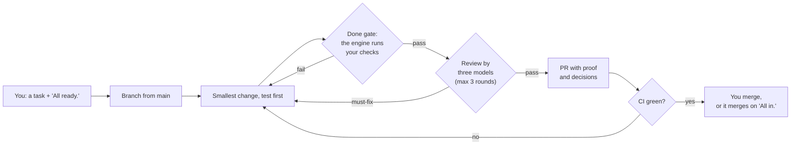

# weftwork

[](https://github.com/djtorel/weftwork/actions/workflows/ci.yml)
[](https://www.npmjs.com/package/weftwork)
[](package.json)
[](LICENSE)

A workflow engine for coding agents. You give the agent a short task; it
works on a branch, proves the change, has it reviewed by models from three
families, and opens a pull request that says what it proved. You answer the
few questions that need a person, and you merge.

Prose instructions alone do not hold an unattended agent to that, so the
engine enforces the parts that matter:

- **"Done" is a command the engine ran and watched pass.** The agent cannot
  say it is done; the Stop hook runs your project's checks and blocks the
  stop until they pass.
- **The loop has counted ceilings.** Runs, failures and review rounds are
  counted in a ledger, and a guard stops the agent from raising its own
  limits or turning off its hooks.
- **A hard stop leaves a handoff.** When the agent must stop early, it opens
  a draft pull request and writes a note the next session picks up.

> **Status:** before 1.0. Claude Code is the only agent host so far. It works
> on new projects and converts bigpowers, GSD, GSD 2, spec-kit and BMAD
> projects.
> Expect changes between minor versions until 1.0
> ([`docs/RELEASING.md`](docs/RELEASING.md)).

## Requirements

- Node.js 26 or later, with npm
- git, and the GitHub CLI [`gh`](https://cli.github.com/) signed in
- [Claude Code](https://docs.anthropic.com/en/docs/claude-code), the agent
  host
- The default reviewers' CLIs: Claude Code, the
  [Codex CLI](https://github.com/openai/codex) and the Antigravity CLI
  (`agy`), for Claude Opus, GPT Sol and Gemini Neon. A missing one drops out
  of the round (any read-only reviewer command works; see
  [Configure](#configure))

## Install

```bash
npm install -g weftwork
weftwork --version
```

If npm cannot write to its global folder, give it a prefix you own first:

```bash
npm config set prefix ~/.local    # and put ~/.local/bin on your PATH
```

**No global install?** Install weftwork into one clone only. git does not
track it, and the project's dependencies do not change:

```bash
cd ~/code/my-project
npx weftwork init --local    # or, in a project already set up: npx weftwork install
```

The skills and hooks find weftwork in this clone, in `node_modules` (a dev
dependency), or on your PATH, in that order. A global `weftwork` hands its
commands to the project's own version. [`docs/INSTALL.md`](docs/INSTALL.md)
has every way, mise included.

<details>
<summary>From source (to work on weftwork)</summary>

```bash
git clone https://github.com/djtorel/weftwork.git
cd weftwork
bash tools/setup.sh
npm link
```

`npm link` puts `weftwork` on your PATH, running this checkout's `src/`
directly. See [`CONTRIBUTING.md`](CONTRIBUTING.md), and
[`docs/ARCHITECTURE.md`](docs/ARCHITECTURE.md) for the map of the code.

</details>

## Quick start

Set up a project (the current folder by default):

```bash
cd ~/code/my-project
weftwork init
```

`init` reads the project and runs its test, lint, typecheck and build
commands once. AGENTS.md marks a command that failed as `(fails today)`,
and the Preflight, the check the agent must pass, takes only the ones that
passed. It asks up to
five questions, each with a recommended answer (press Enter to keep it).
Then it shows every file it would write, as a diff, and writes only when you
say yes. Add `--stop-hook` to install the Claude Code Stop hook and guard,
and `--no-run` for a project whose scripts you do not trust.

It writes `AGENTS.md` (with `CLAUDE.md` linked to it), the agent's skills in
`.claude/skills/`, a few `.gitignore` lines and a local backlog. Commit
them, then open Claude Code in the project and name a task:

> Add a README. All ready.

The agent takes it to a pull request that is ready to merge and stops. It
never merges. End with "All in." instead, and it also merges the pull request
once the merge gate passes, with no questions.

## Skills

Setup puts five skills in `.claude/skills/`. Each starts on a short phrase
that you can end a prompt with.

| Skill | Say | What it does |
| --- | --- | --- |
| `all-ready` | "… All ready." | Takes the task to a pull request that is ready to merge: branch, change, done gate, review, PR, CI. It never merges. |
| `all-in` | "… All in." | The same, then it merges the pull request when the merge gate passes: green checks, review settled, no change requested, the proven commit. You are not asked. |
| `second-opinion` | "Second opinion." | Only the review: read-only reviewers, by default Claude Opus, Codex and Gemini Neon, 3 rounds (5 for a sensitive change). |
| `pr-it` | "PR it." | Only the pull request, with its Proof and Decisions sections. |
| `retro` | "Retro." | With `history: local` on, proposes one small, checked fix for the failure that recurs most in your tasks ([`docs/HISTORY.md`](docs/HISTORY.md)). |

Two more skills, `bootstrap` and `migrate`, are not copied into
projects. They do what `weftwork init` and `weftwork convert` do, from
Claude Code in a weftwork checkout: open it there and say "Bootstrap
/path/to/project" or "Migrate /path/to/project to weftwork".

## Convert an existing project

A project planned with bigpowers (`specs/state.yaml`), GSD (`.planning/`),
GSD 2 (`.gsd/`), spec-kit (`.specify/`) or BMAD (`_bmad/`, or v4's
`.bmad-core/`) keeps its open
work. The conversion tags the old plans, moves the docs that code cites into
`docs/`, untracks the rest, and adds the open items to the backlog:

```bash
cd ~/code/old-project
echo '{}' | weftwork convert                 # the plan; writes nothing
echo '{"apply":true}' | weftwork convert     # convert
weftwork init                                # then a new AGENTS.md
```

If the project already has an AGENTS.md, `init` lists it as a conflict and
keeps it; run `weftwork init --overwrite AGENTS.md` to replace it (the old
one is kept as `AGENTS.md.weftwork-old`).
[`docs/CONVERT.md`](docs/CONVERT.md) has the details and what it refuses.

## How it works



The agent asks you only on a fixed list of triggers: a write outside the
project, a push to `main`, an irreversible or security-sensitive step, a
task too ambiguous to follow, or a check it cannot make pass
([`docs/ASK.md`](docs/ASK.md)). Everything else it decides, and lists each
decision in the pull request.

Optionally, weftwork keeps a record of each task on your machine. It never
uploads it. The record shows which failures keep coming back, and the
`retro` skill proposes one small, tested fix for the most common one, which
you merge or close ([`docs/HISTORY.md`](docs/HISTORY.md)).

## Commands

| Command | What it does |
| --- | --- |
| `weftwork init [path]` | Set up weftwork in a project (default: the current folder) |
| `weftwork update [path]` | Bring a project's weftwork skills to this version |
| `weftwork upgrade` | Install the latest weftwork from npm |
| `weftwork convert` | Convert a bigpowers, GSD, GSD 2, spec-kit or BMAD project (JSON on stdin) |
| `weftwork detect` | Report a project's stack, commands, CI and agent files |
| `weftwork claude-install -- '<cmd>'` | Register the Stop hook and guard for a check command |
| `weftwork claude-live` | Check that Claude Code runs the Stop hook and the guard here |
| `weftwork overlap` | Check that planned parallel tasks change no file in common (JSON on stdin) |
| `weftwork measure` | Measure the done gate against seeded false successes (JSON on stdin) |
| `weftwork history` | Report the failures that recur across your tasks (JSON on stdin; `{}` reports) |
| `weftwork path` | Print where weftwork is installed (its docs and skills) |
| `weftwork --help` | List every command, including the ones the agent's skills call |

`weftwork init --help` lists its options. Most other commands read one JSON
object on stdin and print one JSON line; each has a page in
[`docs/`](docs/).

## Configure

An optional `weftwork.yaml` at the project root changes the defaults. The
agent cannot edit it: the guard blocks that.

```yaml
---
budget:              # docs/BUDGET.md
  max_runs: 40
  max_failures: 3
review:              # docs/REVIEW.md
  max_rounds: 3
  reviewers:
    - codex exec --ignore-user-config --sandbox read-only --ephemeral -
ui:                  # docs/UI.md: before and after screenshots for UI changes
  screenshot: npx playwright test e2e/screenshots.spec.ts
  paths: ['web/**']
history: local       # docs/HISTORY.md: keep a local record of each task
```

Your own defaults for every project go in
`~/.config/weftwork/config.yaml`.

## Update

When a new weftwork is out:

```bash
weftwork upgrade          # install the latest weftwork from npm
cd ~/code/my-project
weftwork update           # bring the project's skills up to it
```

The hooks run the `weftwork` they find, so they change with the upgrade. In
a project with its own install, `upgrade` upgrades that one and moves the
pin in `weftwork.yaml`; commit it.
The skills are copied into each project, so `update` replaces each skill
file you never changed, adds the new ones, and keeps any you changed. It
never touches AGENTS.md. Commit what it changed
([`docs/SETUP.md`](docs/SETUP.md#update)).

## Undo

Before you commit a setup:

```bash
cd ~/code/my-project
echo '{"undo":true}' | weftwork setup
```

It removes what setup wrote and restores what it moved aside, but keeps any
file you changed since. After a commit, revert it.
[`docs/GETTING-STARTED.md`](docs/GETTING-STARTED.md#4-undo) covers a
conversion too. To remove weftwork itself: `npm uninstall -g weftwork`.

## Documentation

| Page | About |
| --- | --- |
| [Getting started](docs/GETTING-STARTED.md) | From install to the first all-ready run, step by step |
| [Setup](docs/SETUP.md), [Convert](docs/CONVERT.md) and [Detect](docs/DETECT.md) | What `init` and `convert` read, ask and write |
| [Guard](docs/GUARD.md) and [Ask](docs/ASK.md) | What the agent may not do, and when it asks you |
| [Security baseline](docs/SECURITY-BASELINE.md) | Repository content is data, each host's boundary, and keeping credentials out |
| [Parallel work](docs/PARALLEL.md) | The file-overlap check before parallel tasks |
| [Review](docs/REVIEW.md), [Base check](docs/BASE-CHECK.md), [UI](docs/UI.md) | The reviewers and their checks |
| [Budget](docs/BUDGET.md), [State](docs/STATE.md), [PR proof](docs/PR-PROOF.md) | Ceilings, the handoff, and what a PR proves |
| [History](docs/HISTORY.md) | The opt-in local record of tasks, and how a recurring failure becomes a fix |
| [Measure](docs/MEASURE.md) | The harness that measures the done gate against an oracle |
| [Releasing](docs/RELEASING.md) | Versions, releases and what counts as a breaking change |
| [Research](docs/research/) | The evidence behind the design ([synthesis](docs/research/SYNTHESIS.md)) |

## Contributing

Issues and pull requests are welcome. Start with
[`CONTRIBUTING.md`](CONTRIBUTING.md); [`AGENTS.md`](AGENTS.md) is the project
context for people and agents working on weftwork. Report security problems
privately ([`SECURITY.md`](SECURITY.md)).

## License

[MIT](LICENSE). The `all-ready`, `all-in`, `second-opinion` and `pr-it` skills are
adapted from Theo Browne's [tstack](https://github.com/t3dotgg/tstack) (MIT;
see [`.claude/skills/README.md`](.claude/skills/README.md)).
