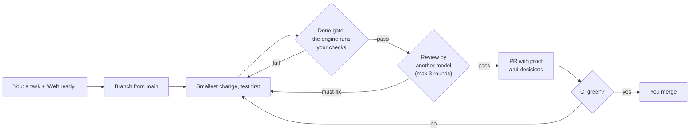

# weftwork

[](https://github.com/djtorel/weftwork/actions/workflows/ci.yml)
[](https://www.npmjs.com/package/weftwork)
[](package.json)
[](LICENSE)

A workflow engine for coding agents. You give the agent a short task; it
works on a branch, proves the change, has it reviewed by a model from another
family, and opens a pull request that says what it proved. You answer the
few questions that need a person, and you merge.

Prose instructions alone do not hold an unattended agent to that, so the
engine enforces the parts that matter:

- **"Done" is a command the engine ran and watched pass.** The agent cannot
  say it is done; the Stop hook runs your project's checks and blocks the
  stop until they pass.
- **The loop has counted ceilings.** Runs, failures and review rounds are
  counted in a ledger, and a guard stops the agent from raising its own
  limits or turning off its hooks.
- **A hard stop leaves a handoff.** When the agent must stop early, it opens
  a draft pull request and writes a note the next session picks up.

> **Status:** before 1.0. Claude Code is the only agent host so far. It works
> on new projects and converts bigpowers, GSD, spec-kit and BMAD projects.
> Expect changes between minor versions until 1.0
> ([`docs/RELEASING.md`](docs/RELEASING.md)).

## Requirements

- Node.js 26 or later, with npm
- git, and the GitHub CLI [`gh`](https://cli.github.com/) signed in
- [Claude Code](https://docs.anthropic.com/en/docs/claude-code), the agent
  host
- The [Codex CLI](https://github.com/openai/codex), the default reviewer
  (any read-only reviewer command works; see [Configure](#configure))

## Install

```bash
npm install -g weftwork
weftwork --version
```

The skills and hooks that weftwork puts into a project call the `weftwork`
command, so install it globally rather than only running it with `npx`. If
npm cannot write to its global folder, give it a prefix you own first:

```bash
npm config set prefix ~/.local    # and put ~/.local/bin on your PATH
```

`npx weftwork@latest init` runs setup without a global install, but the
skills it writes still need `weftwork` on your PATH to run.

<details>
<summary>From source (to work on weftwork)</summary>

```bash
git clone https://github.com/djtorel/weftwork.git
cd weftwork
bash tools/setup.sh
npm link
```

`npm link` puts `weftwork` on your PATH, running this checkout's `src/`
directly. See [`CONTRIBUTING.md`](CONTRIBUTING.md).

</details>

## Quick start

Set up a project (the current folder by default):

```bash
cd ~/code/my-project
weftwork init
```

`init` reads the project and runs its test, lint, typecheck and build
commands once. AGENTS.md marks a command that failed as `(fails today)`,
and the Preflight, the check the agent must pass, takes only the ones that
passed. It asks up to
five questions, each with a recommended answer (press Enter to keep it).
Then it shows every file it would write, as a diff, and writes only when you
say yes. Add `--stop-hook` to install the Claude Code Stop hook and guard,
and `--no-run` for a project whose scripts you do not trust.

It writes `AGENTS.md` (with `CLAUDE.md` linked to it), the agent's skills in
`.claude/skills/`, a few `.gitignore` lines and a local backlog. Commit
them, then open Claude Code in the project and name a task:

> Add a README. Weft ready.

The agent takes it to a pull request that is ready to merge and stops. It
never merges.

## Convert an existing project

A project planned with bigpowers (`specs/state.yaml`), GSD (`.planning/`),
GSD 2 (`.gsd/`), spec-kit (`.specify/`) or BMAD (`_bmad/`, or v4's
`.bmad-core/`) keeps its open
work. The conversion tags the old plans, moves the docs that code cites into
`docs/`, untracks the rest, and adds the open items to the backlog:

```bash
cd ~/code/old-project
echo '{}' | weftwork convert                 # the plan; writes nothing
echo '{"apply":true}' | weftwork convert     # convert
weftwork init                                # then a new AGENTS.md
```

If the project already has an AGENTS.md, `init` lists it as a conflict and
keeps it; run `weftwork init --overwrite AGENTS.md` to replace it (the old
one is kept as `AGENTS.md.weftwork-old`).
[`docs/CONVERT.md`](docs/CONVERT.md) has the details and what it refuses.

## How it works



The agent asks you only on a fixed list of triggers: a write outside the
project, a push to `main`, an irreversible or security-sensitive step, a
task too ambiguous to follow, or a check it cannot make pass
([`docs/ASK.md`](docs/ASK.md)). Everything else it decides, and lists each
decision in the pull request.

## Commands

| Command | What it does |
| --- | --- |
| `weftwork init [path]` | Set up weftwork in a project (default: the current folder) |
| `weftwork convert` | Convert a bigpowers, GSD, spec-kit or BMAD project (JSON on stdin) |
| `weftwork detect` | Report a project's stack, commands, CI and agent files |
| `weftwork claude-install -- '<cmd>'` | Register the Stop hook and guard for a check command |
| `weftwork claude-live` | Check that Claude Code runs the Stop hook and the guard here |
| `weftwork path` | Print where weftwork is installed (its docs and skills) |
| `weftwork --help` | List every command, including the ones the agent's skills call |

`weftwork init --help` lists its options. Most other commands read one JSON
object on stdin and print one JSON line; each has a page in
[`docs/`](docs/).

## Configure

An optional `weftwork.yaml` at the project root changes the defaults. The
agent cannot edit it: the guard blocks that.

```yaml
---
budget:              # docs/BUDGET.md
  maxRuns: 40
  maxFailures: 3
review:              # docs/REVIEW.md
  max_rounds: 3
  reviewers:
    - codex exec --ignore-user-config --sandbox read-only --ephemeral -
ui:                  # docs/UI.md: before and after screenshots for UI changes
  screenshot: npx playwright test e2e/screenshots.spec.ts
  paths: ['web/**']
```

Your own defaults for every project go in
`~/.config/weftwork/config.yaml`.

## Undo

Before you commit a setup:

```bash
cd ~/code/my-project
echo '{"undo":true}' | weftwork setup
```

It removes what setup wrote and restores what it moved aside, but keeps any
file you changed since. After a commit, revert it.
[`docs/GETTING-STARTED.md`](docs/GETTING-STARTED.md#4-undo) covers a
conversion too. To remove weftwork itself: `npm uninstall -g weftwork`.

## Documentation

| Page | About |
| --- | --- |
| [Getting started](docs/GETTING-STARTED.md) | From install to the first weft-ready run, step by step |
| [Setup](docs/SETUP.md) and [Convert](docs/CONVERT.md) | What `init` and `convert` read, ask and write |
| [Guard](docs/GUARD.md) and [Ask](docs/ASK.md) | What the agent may not do, and when it asks you |
| [Review](docs/REVIEW.md), [Base check](docs/BASE-CHECK.md), [UI](docs/UI.md) | The reviewers and their checks |
| [Budget](docs/BUDGET.md), [State](docs/STATE.md), [PR proof](docs/PR-PROOF.md) | Ceilings, the handoff, and what a PR proves |
| [Measure](docs/MEASURE.md) | The harness that measures the done gate against an oracle |
| [Releasing](docs/RELEASING.md) | Versions, releases and what counts as a breaking change |
| [Research](docs/research/) | The evidence behind the design ([synthesis](docs/research/SYNTHESIS.md)) |

## Contributing

Issues and pull requests are welcome. Start with
[`CONTRIBUTING.md`](CONTRIBUTING.md); [`AGENTS.md`](AGENTS.md) is the project
context for people and agents working on weftwork. Report security problems
privately ([`SECURITY.md`](SECURITY.md)).

## License

[MIT](LICENSE). The `weft-ready`, `weft-review` and `weft-pr` skills are
adapted from Theo Browne's [tstack](https://github.com/t3dotgg/tstack) (MIT;
see [`.claude/skills/README.md`](.claude/skills/README.md)).
